# Bonxie

A writing application for macOS. Plan an outline, collect notes and sources
on an infinite canvas, and write with reference material beside your draft.

Currently only supports Apple Silicon.

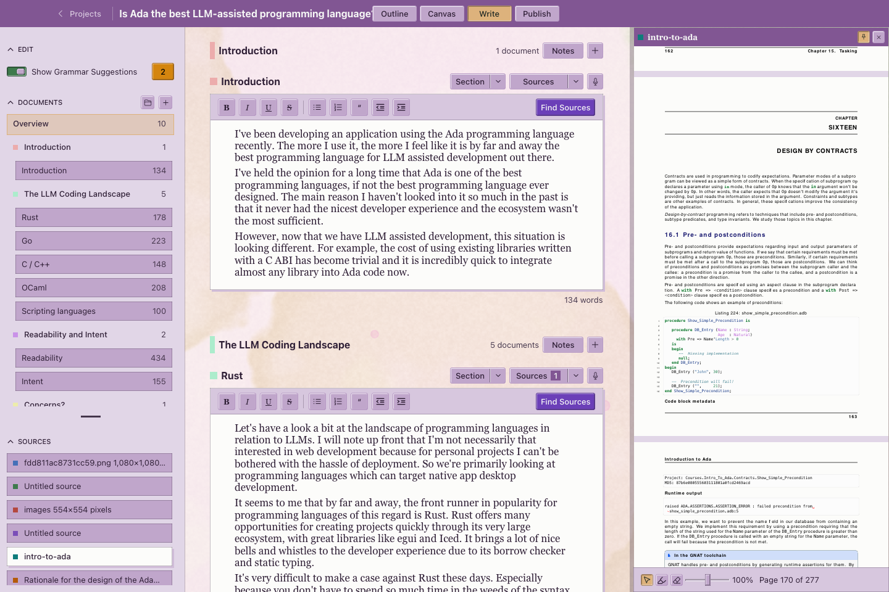

## At a glance

- **Outlining:** plan your project with a description, coloured sections and section notes.
- **2D planning:** arrange and connect documents and sources on an infinite canvas.
- **Dictation and transcription:** speech-to-text using macOS speech recognition or Parakeet (recommended).
- **Grammar and spelling:** review suggestions from [Harper](https://writewithharper.com/) as you write.
- **Flexible structure:** reorder sections and documents, and organise drafts into folders.
- **Sources beside your writing:** view web pages, PDFs, EPUBs, text files and images; pin references and add highlights.
- **Themes:** light or dark mode, with optional procedural backgrounds and colour variations.
- **Alternative wordings:** use Reword to keep and compare different versions of a passage.

## TODO

- Better editing workflows
- More export targets (pdf, ebook, text)
- More places to put notes
- Project-level undo
- Version control
- Backups / syncing
- Cross platform?

Patches welcome!

# Screenshots

## Outlining

The outline holds a project's description, ordered sections, colours and section notes.

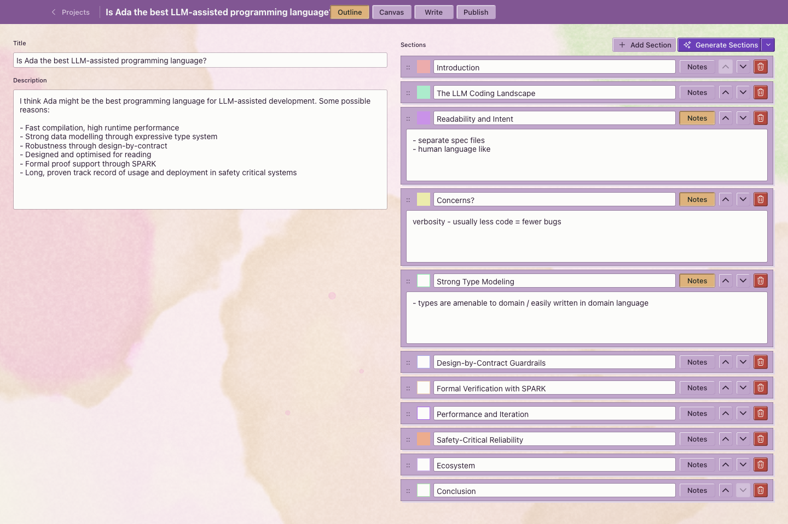
*Outline view*

## Alternative wordings

Use reword to create different phrasings for parts of your writing. It's easy to cycle through the options as see which reads the best.

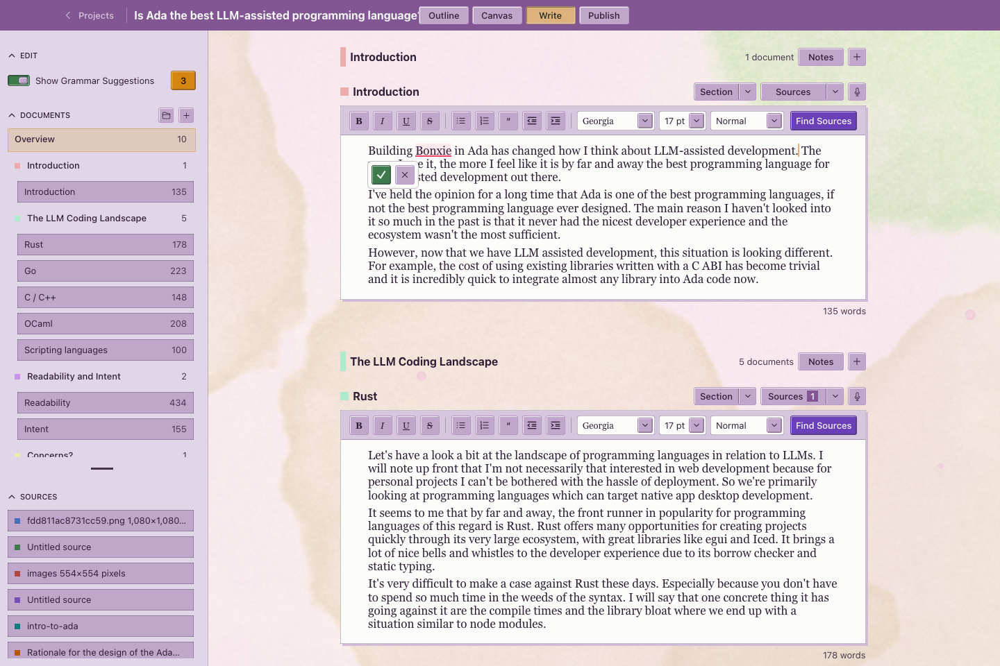
*During rewording*

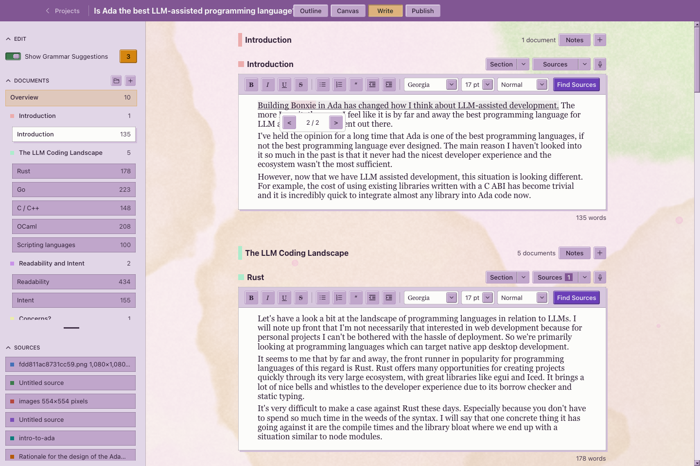
*Cycling available versions*

## Canvas

Plan your project on an infinite canvas, making it easy to get an overview of sections and how they relate to your sources.

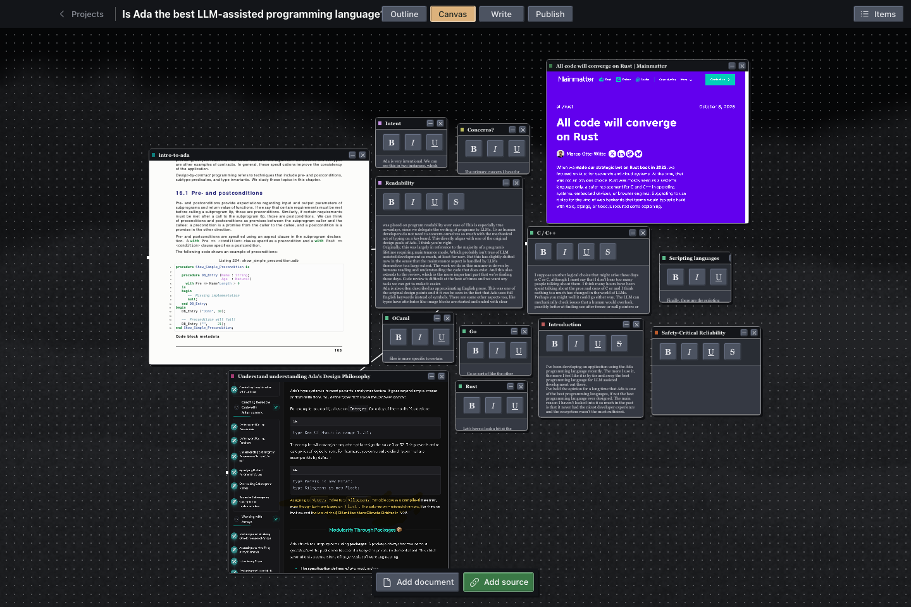
*Zoomed out*

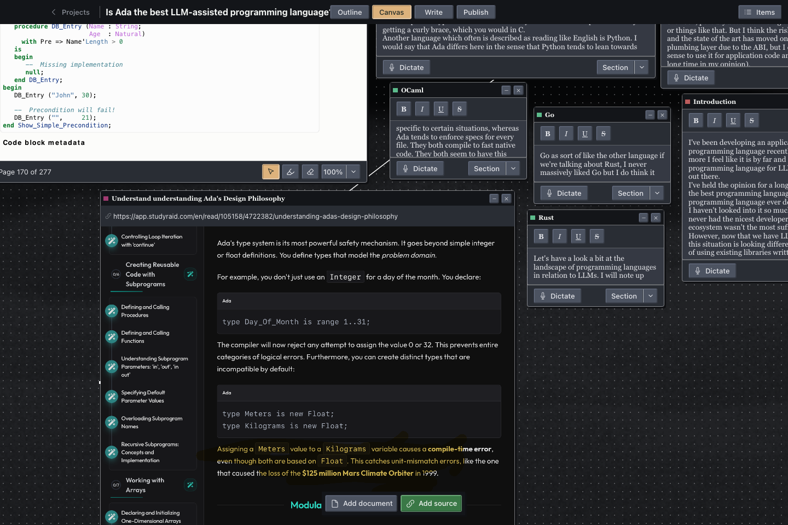
*A closer look*

## Themes

It comes with a couple of different procedural themes, as well as a fixed colour light/dark mode.

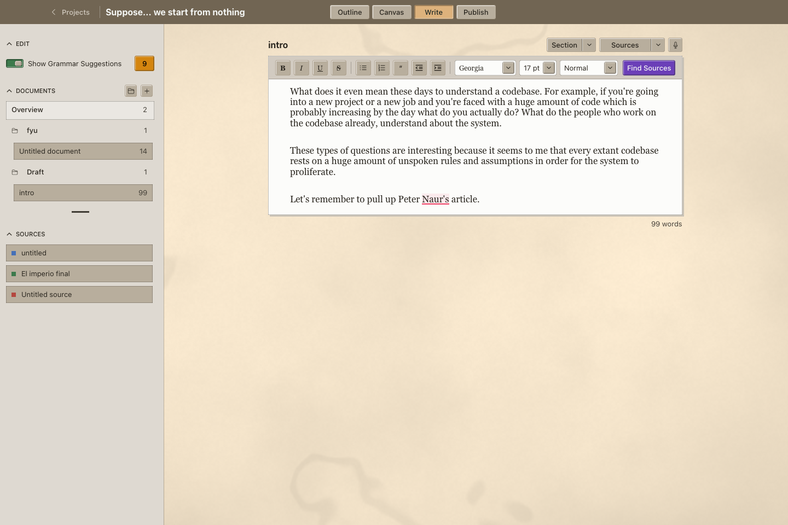

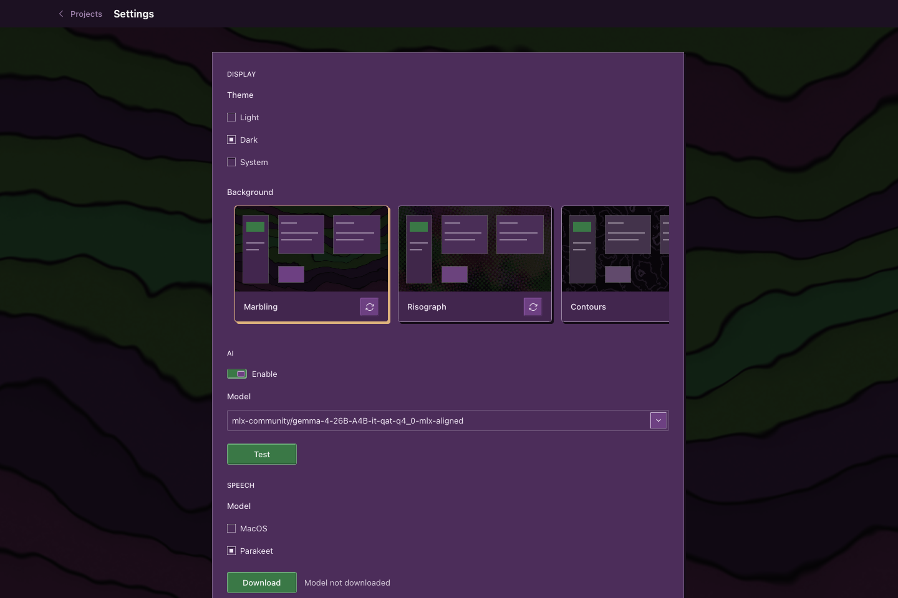
*Settings page*

## Dictation

Fast speech-to-text with [Parakeet](https://huggingface.co/FluidInference/parakeet-tdt-0.6b-v3-coreml) (recommended) or the built in macOS one (slow).

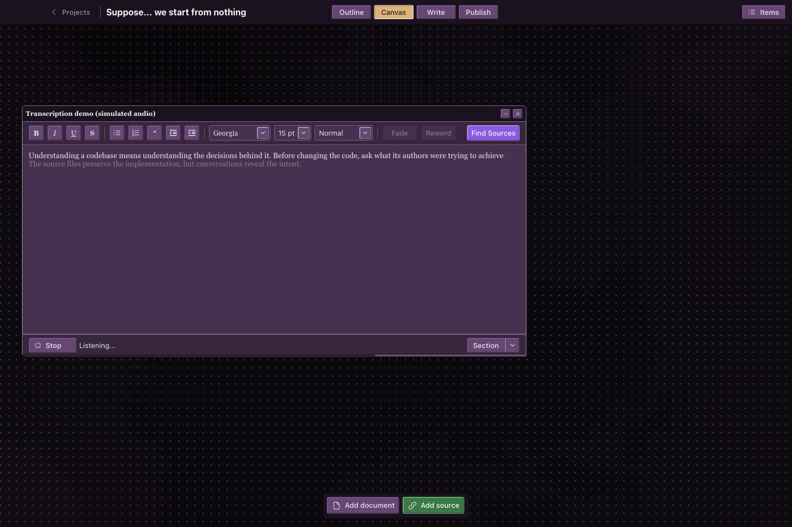
*Live dictation*

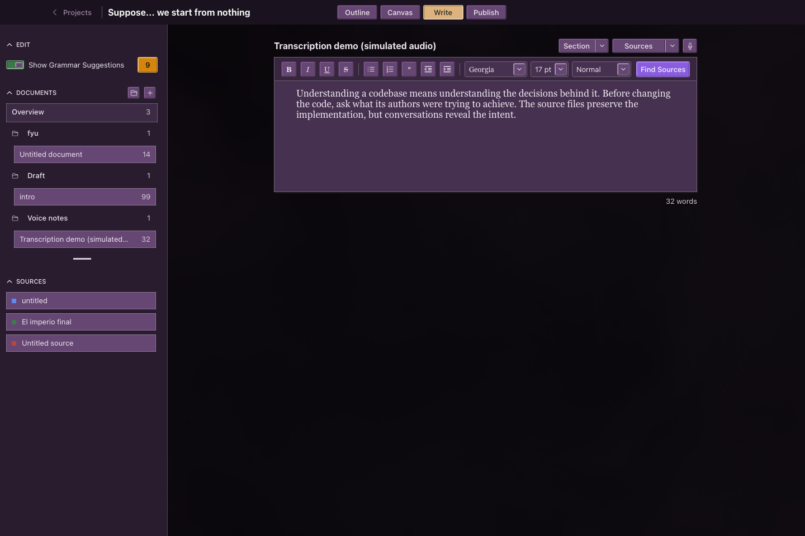
*Accepted transcript*

## Projects

Separate your work by project (home screen).

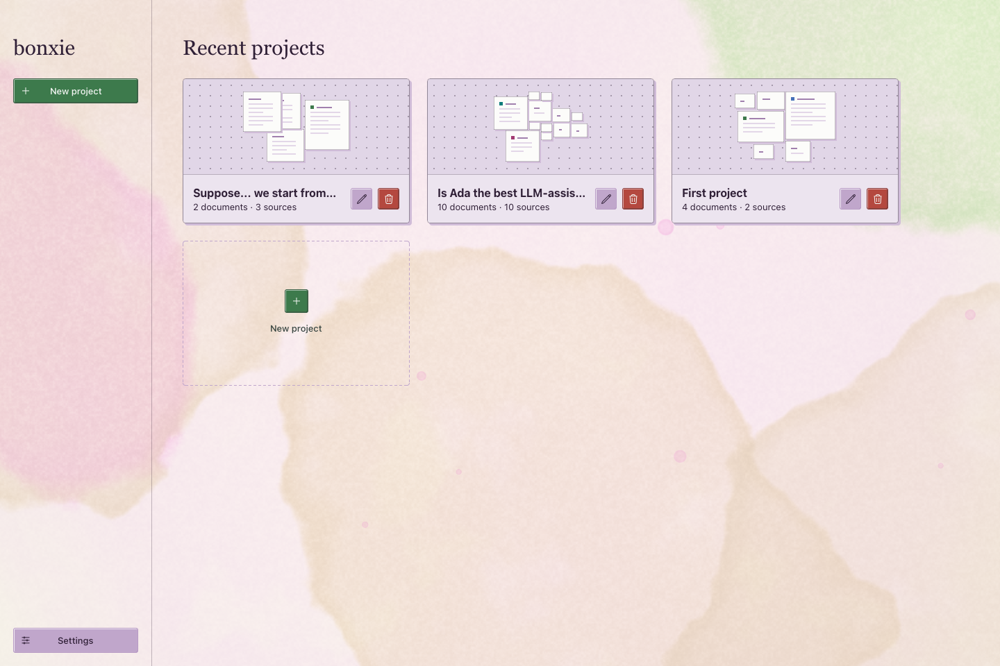
*Recent projects*