# Bonxie

A writing application for macOS. Plan an outline, collect notes and sources
on an infinite canvas, and write with reference material beside your draft.

Currently only supports Apple Silicon.

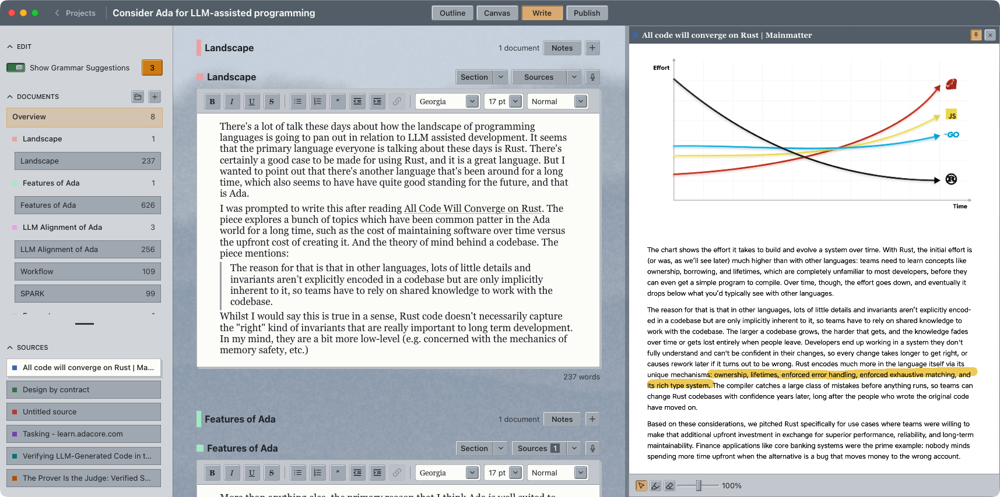

*Full workflow, writing with research*

## Features

- **Outlining:** plan your project with a description, coloured sections and section notes.
- **2D planning:** arrange and connect documents and sources on an infinite canvas.
- **Dictation and transcription:** speech-to-text using macOS speech recognition or Parakeet (recommended).
- **Grammar and spelling:** review suggestions from [Harper](https://writewithharper.com/) as you write.
- **Flexible structure:** reorder sections and documents, and organise drafts into folders.
- **Sources beside your writing:** view web pages, PDFs, EPUBs, text files and images; pin references and add highlights.
- **Themes:** light or dark mode, with optional procedural backgrounds and colour variations.
- **Alternative wordings:** use Reword to keep and compare different versions of a passage.

## TODO

- Better editing workflows
- More export targets (pdf, ebook, text)
- More places to put notes
- Project-level undo
- Version control
- Backups / syncing
- Cross platform?

Patches welcome!

# Screenshots

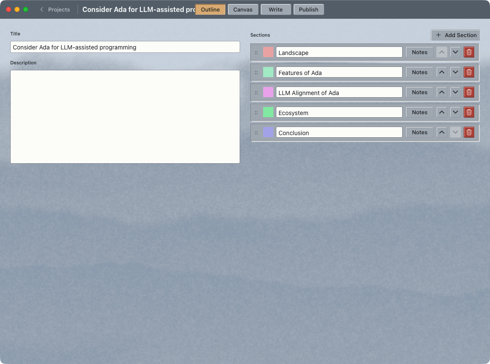

*Create an outline for your project*

---

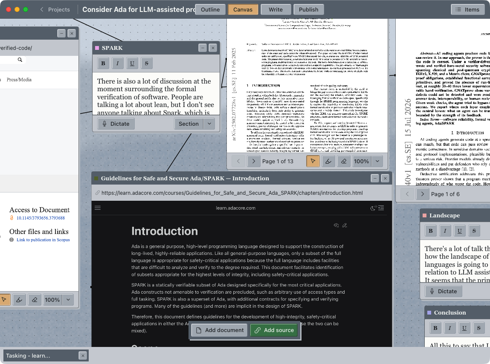

*See writing and sources on a 2d canvas, create links between writing and research*

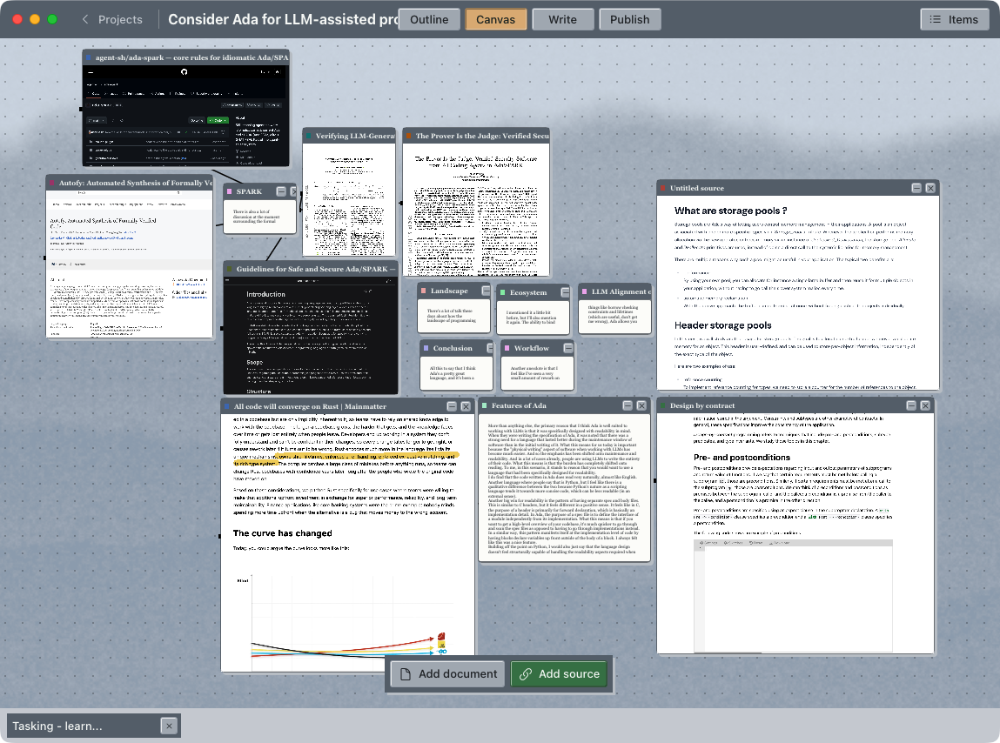

*Zoomed out view of the infinite canvas*

---

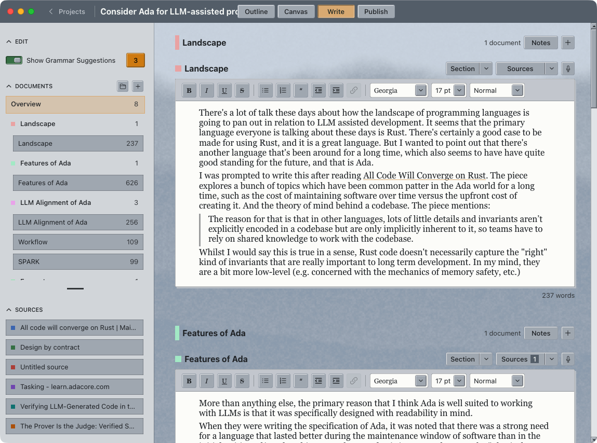

*Rich text editing*

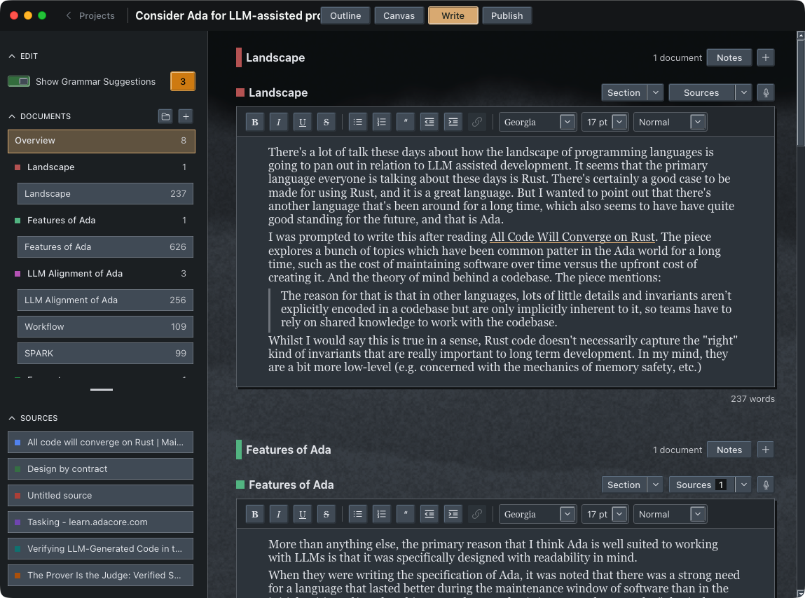

*Dark mode supported*

---

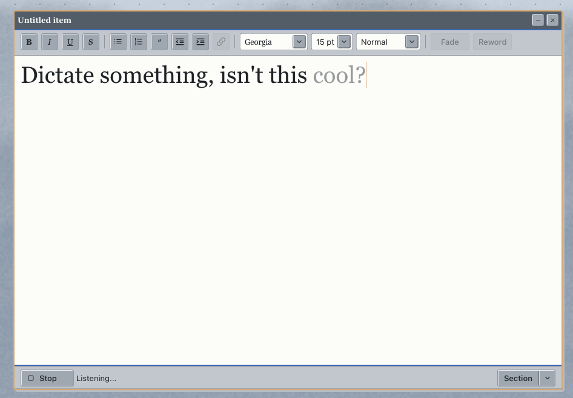

*Dictation with macOS or Parakeet (recommended)*

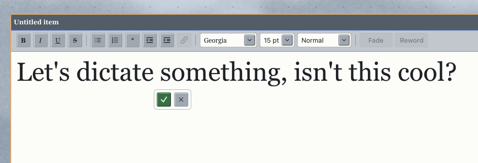

*Rewording: give alternative wordings to your writing*

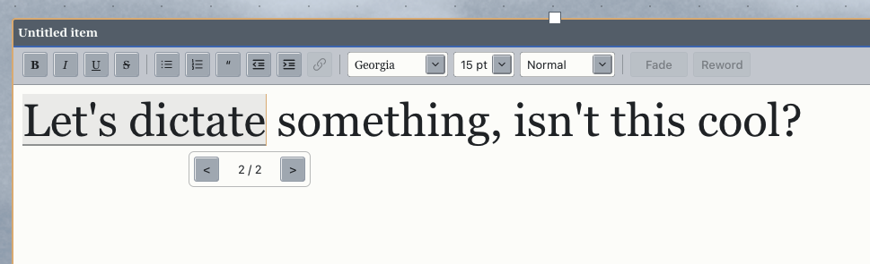

*Cycle alternative versions of rewordings inline*

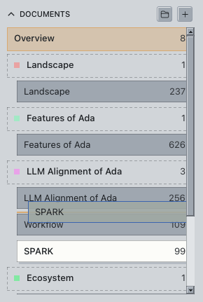

*Easily reorder the parts of your project*

---

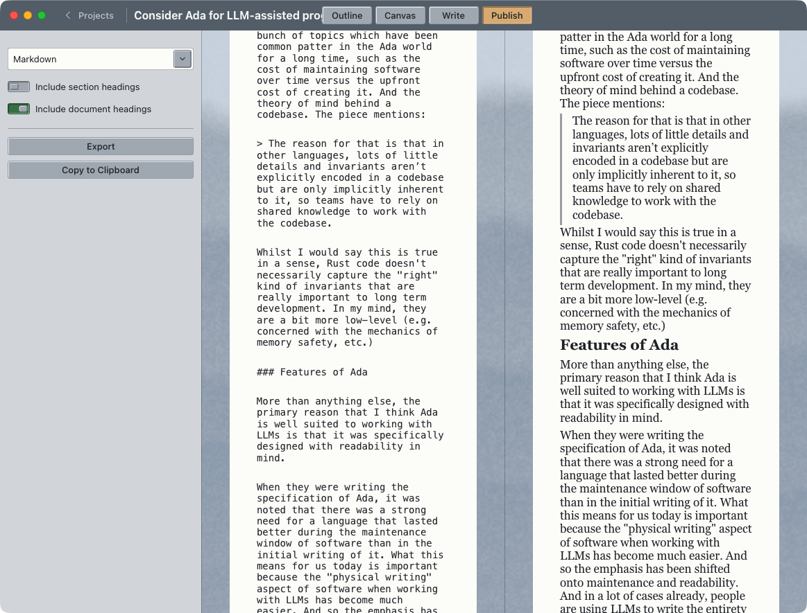

*Export your writing*

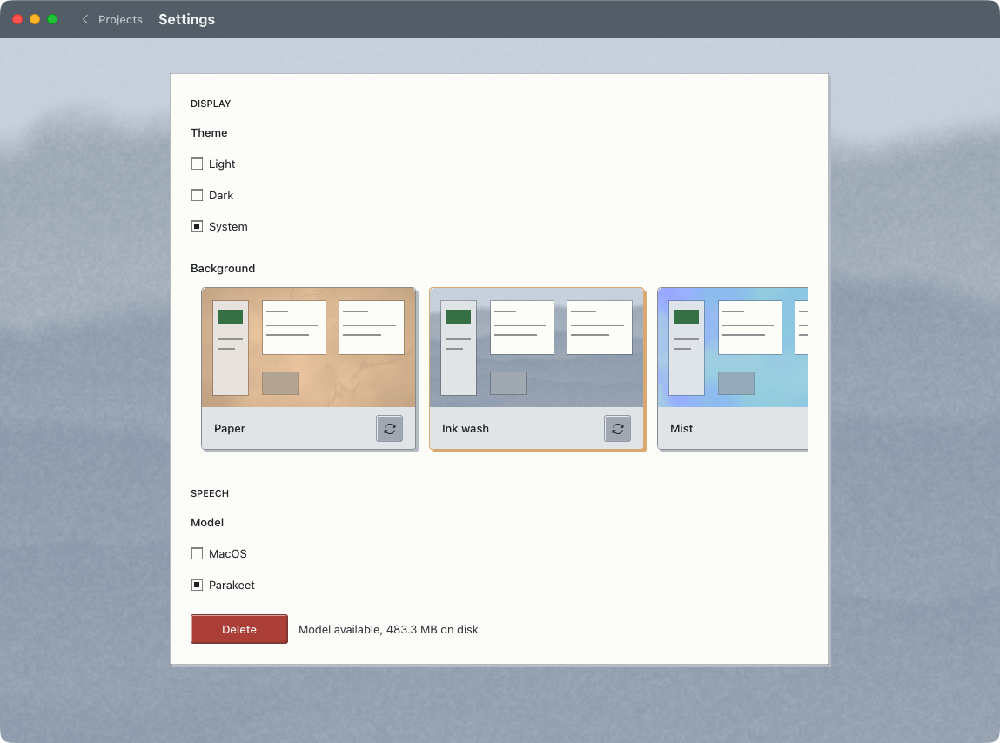

*Configurable themes and colours*

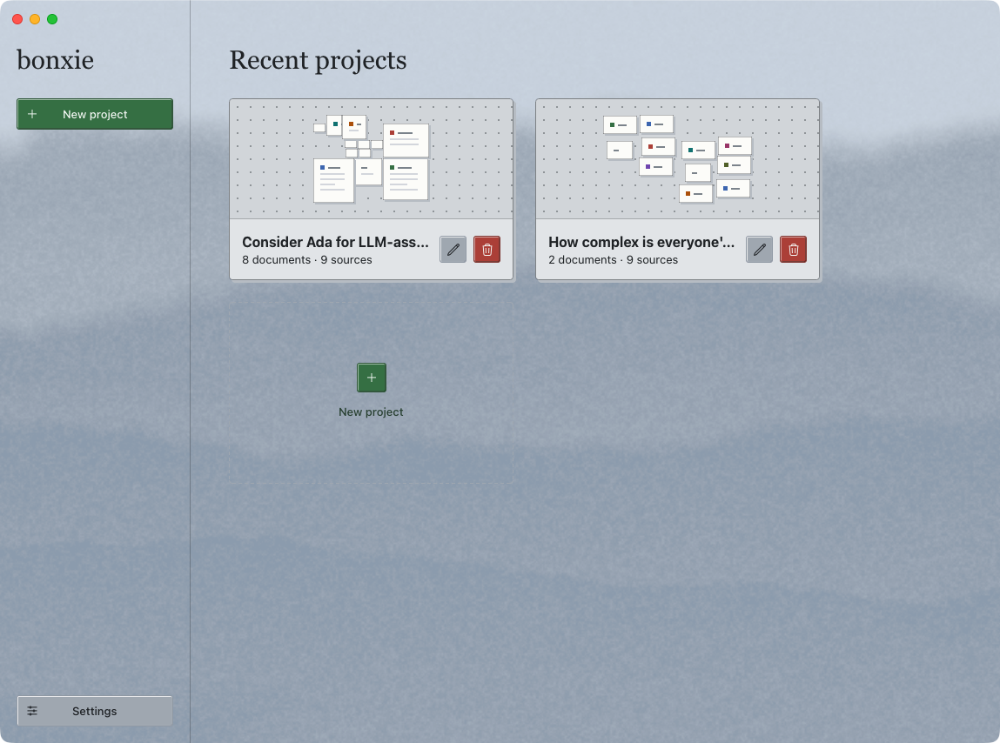

*Projects view*